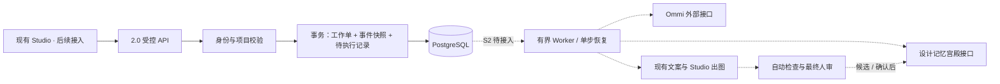
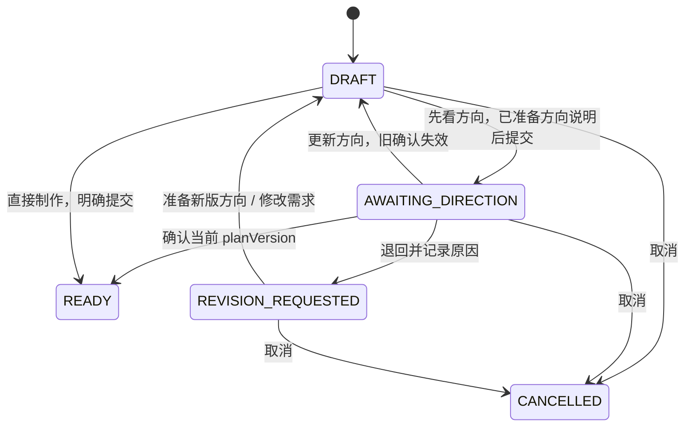

# 2.0 骨架架构

## 复用与新增

保留 Next.js BFF、TypeScript、Prisma/PostgreSQL、BullMQ、现有 Studio/文案/生成服务和 FastAPI。新增范围集中在 `apps/web/src/lib/deepflare-v2`、`packages/contracts/src/deepflare-v2.ts`、Python 镜像以及三张独立表。旧生成路径未改，Ommi 仓库未触碰。

虚线是后续接入；本批没有真模型执行。

## 方向确认

`revision` 是每次操作的并发版本；`planVersion` 只在需求/方向内容变化时增加；`approvedPlanVersion` 绑定确认内容。退回修改后没有直达执行的边。方向说明只是数据合同，粗构图产物展示待 U-02。

READY 在本批是终端交接状态，没有运行中的 UI 或自动付费调用。R-01 需新增 EXECUTING / BLOCKED / AWAITING_REVIEW 等真正的执行状态，关联具体步骤、lease、deadline、付费请求回执与取消。不可仅把 READY 改名 RUNNING。

## 持久化与并发

- `DeepFlareWorkOrder`：品牌/项目、创建者、当前 revision 与 state。
- `DeepFlareWorkOrderEvent`：操作者、mutationId、请求哈希、命令、不可变状态快照。每个工作单 revision 唯一。
- `DeepFlareWorkOrderDispatch`：已确认 planVersion 的不可变快照；工作单+planVersion 唯一。只是 outbox，尚无消费者。

创建与操作使用 Serializable 事务，最多重试三次 P2002/P2034。同 mutationId 与相同 payload 返回原回执，换内容返回 409；新 mutationId 携带旧 revision 返回 409。变更状态、追加事件、插入派发记录全部成功才提交。Redis 不参与该事务，HTTP 不等待外部调用。

GET 可恢复服务端状态；同 mutationId 重试返回那次操作的快照，前端之后应 GET 最新状态。任务中的步骤图是有向依赖声明，不代表子员工已经完成任何步骤。

权限在同一事务中检查当前账号、品牌归属/成员、项目归属及归档状态。OWNER/EDITOR 可操作方向；REVIEWER/VIEWER 只读。最终稿审核的职责分离由 Q-01 对接现有稿件审核权限，不能沿用此处编辑权限直接批准终稿。

## AI 员工与记忆

| 岗位 | 等待什么 | 读取什么 |
|---|---|---|
| 灵感研究员 | 当前 brief 与明确选择 | 灵感记忆；Ommi 指定版本的借鉴点 |
| 文案策划 | 灵感步骤 | 文案记忆、项目反馈 |
| 视觉设计师 | 灵感步骤；整个计划已过方向门 | 视觉记忆、项目反馈 |
| 渠道适配 | 文案与主视觉 | 视觉记忆、项目反馈 |
| QA | 文案、主视觉及全部渠道适配 | 反馈记忆和现有确定性品牌规则 |

AI 项目负责人当前由一个固定的上新 recipe 承担分派；没有声称通用自然语言任务分解已实现。先固定一条可测流程，再增加可替换 planner。

记忆读取接口只返回当前品牌/项目的 CONFIRMED 条目。反馈写入接口只产生 CANDIDATE；需要来源稿件版本。后续实现还必须补访问重验、撤回、冲突处理、执行回执及删除语义。接口并不等于权限实现。

## 迁移与回退

迁移 `20261112090000_deepflare_v2_foundation` 只新增三张表及索引/外键，不重写旧数据，不修改 JobStatus。Project 删除会级联删除本项目工作单与快照。

本轮仅允许对一次性测试数据库执行迁移。分区运行前须核对 F-08 的独立资源；不对主分支或正式数据库执行迁移。开关关闭后接口 404；普通 Studio 不依赖此开关。未来有消费者时，关闭入口不等于停止队列，必须另行实现停止领取与在途任务清单。
