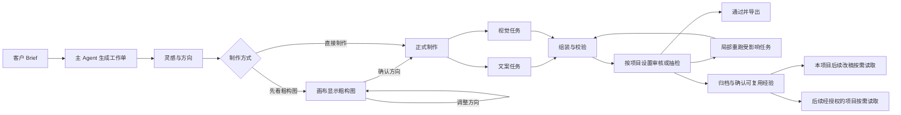

# DeepFlare 2.0 设计记忆宫殿产品方案

评审稿 v0.4 · 2026-11-11

设计师在项目里提交客户 brief，DeepFlare 整理交付要求，调用品牌规则、已审案例和灵感参考，调度现有的作图、文案和灵感能力，最后把成套结果交给设计师审核。审核中的修改、采用理由和适用范围会回到记忆宫殿，让同一品牌下一次遇到类似任务时少走一轮弯路。

「设计大脑」是用户体验。「设计记忆宫殿」负责保存设计判断、为任务找到适用的经验，并说明本次用了什么。**2.0 首先优化 Ommi 灵感，把选定的做法接进当前项目工作台。** 设计师找到案例、选取具体方法，用现有 Studio 出图，再从结果回查本轮发送的依据。接下来在同一项目跑通 AI 团队和审核写回，最后验证经授权的跨项目复用。 [实施优先级与试点计划](<DeepFlare 2.0 实施优先级与试点计划.md>)

## 产品评审

| 方向 | 2.0 的产品决定 |
|---|---|
| 灵感纳入记忆 | 首先把设计师明确选用的灵感方法、出处和用途带进当前项目。后续提炼可复用的候选，经确认后供其他项目按范围调用。 |
| 项目产出与反馈纳入记忆 | 项目内自动归档版本和评审。选出有解释价值的案例，保留需求、修改前后、通过或驳回的理由，以及适用条件。品牌长期规则由有权限的人确认。 |
| 一段 brief 拆成多个任务 | 主 Agent 输出可执行工作单并分派有限的任务类型。子 Agent 读取与自身任务有关的材料，提交有格式的结果，由工作流做依赖、权限、状态和预算控制。 |
| 设计师何时介入 | 精细设计可先看一版粗构图，确认方向后再制作文案、视觉和渠道变体。已有模板或方向明确的批量任务可直接制作。需要补资料、处理冲突或核验结果时，再交给相应负责人。 |

## 竞品做法与 2.0 取舍

核对范围包括官方操作文档、演示、公开接口和工作流样例，以及本地已有的 Lovart 分层调研记录。FLORA 还核对了匿名工具目录实际返回的字段。表中 DeepFlare 的做法是据此选定的设计，同题生成与审稿结果由试点验证。

| 环节 | 竞品公开做法 | DeepFlare 设计决定 |
|---|---|---|
| **P0 · 带参考进创作** | Lovart 的研究报告可加入对话，报告图片也可放到画布。Firefly Boards 演示从画布选图或截取区域，明确送入本轮生成。 [Lovart 研究](https://www.lovart.ai/news/lovart-2-0-arti) · [Lovart 引用操作](https://www.lovart.ai/docs/how-to-prompt/adding-references) · [Firefly Boards 演示，03:05 起](https://www.adobe.com/learn/firefly/web/create-moodboard-with-firefly-boards) | 现有工作台输入区点「添加灵感」，或从案例详情点「用到当前项目」。先带入已获准用于出图的文字借鉴点及出处。本轮勾选决定发送哪些，成品回查本次发送的要点和来源版本。需要采用原图时，走既有素材权限与画布引用入口。 |
| **P1 · 启动一套工作** | Lovart Skills 按任务模板补齐缺项后执行，设计委派可先试跑、记录用量。FLORA Techniques 公开了声明输入输出、发起异步运行、按运行 ID 查状态和费用的接口。Adobe Firefly Capsules 的 beta 只向使用者露出需要操作的字段。 [Lovart Skills](https://www.lovart.ai/docs/how-to-prompt/agent-skills) · [Lovart 设计委派](https://www.lovart.ai/news/lovart-2-0-arti) · [FLORA 公开工具](https://docs.flora.ai/mcp/tools.md) · [FLORA 运行样例](https://github.com/florafauna-ai/flora-mcp-skills/blob/main/skills/flora-run-technique/SKILL.md) · [Adobe Capsules](https://helpx.adobe.com/firefly/web/work-with-enterprise-features/creative-production/interface-overview.html) | 先提供一个「品牌上新」工作单，沿用当前 Brief、商品原图和渠道规格。工作台只显示待补项、交付物和进度。后台用现有 Worker 执行有明确输入、依赖和输出的步骤；遇到必要素材缺失、规则冲突或费用边界再停下来。 |
| **P1 · 做出可编辑的上新稿** | Canva Autofill 先读取模板可填字段及类型，再异步填入文本和素材。Adobe 把保持商品原样的精确合成与可重新生成商品的适配合成分为不同操作。即梦企业方案以商品图、卖点和活动主题作为电商工作流输入。 [Canva Autofill](https://www.canva.dev/docs/apps/rest-apis/reference/autofills/) · [Adobe 合成接口](https://developer.adobe.com/firefly-services/docs/firefly-api/guides/how-tos/object-composite/) · [即梦电商方案](https://jimeng.jianying.com/ai-tool/business) | 用现有画布、文案和导出能力组装母版与渠道稿。标题、商品图、背景分别填入可编辑位置。要求保留商品原样时，优先用已验证的原图图层或蒙版合成。提示词和模型核验的结果按实际证据展示。 |
| **P1 · 评审与局部重做** | Lovart 把意见钉在具体元素上，再让设计师选择意见并确认修改方案。Workfront Proof 将意见、审批和权限绑定到稿件版本，新旧版本可对照。 [Lovart 改稿流程](https://www.lovart.ai/tools/ai-design-feedback-tool) · [Workfront 稿件版本](https://experienceleague.adobe.com/en/docs/workfront/using/workfront-proof/work-with-proofs-in-wf-proof/manage-your-work/manage-proof-versions) | 在现有右侧审核区显示当前稿件版本，意见能指向选定稿件或图层。改动生成新版本，只重跑受影响步骤并审核对应结果。先复用现有生成版本的审核记录。 |
| **P1/P2 · 记忆与授权** | Lovart 允许查看、编辑、删除个人记忆并控制跨项目使用。Canva 的个人记忆资料页用于风格与偏好。Adobe 的品牌规范独立管理并可用于检查。 [Lovart 记忆](https://www.lovart.ai/topics/lovart-2-0) · [Canva 记忆库](https://www.canva.com/en_gb/help/memory-library/) · [Firefly 品牌规则](https://helpx.adobe.com/firefly/web/firefly-ai-assistant/build-and-work-with-brands.html) | 把可编辑、可撤回的机制用在项目审核经验上。候选引用反馈和通过稿，设计师在审核处确认，默认仅本项目。需要跨项目时再授权范围，升级为品牌硬规则走现有规则确认。 |

实现优先复用现有项目资料、工作台、生成队列和版本审核。2.0 自身要补齐的是**选用的依据怎样进入本次任务，以及审核决定怎样在后续结果中可追溯**。已有 Lovart 分层调研中的源图保护、按需澄清和局部检查，可继续用在视觉步骤。 [已有 Lovart 分层调研记录](https://github.com/nickzhang2999-dev/brandai-platform/blob/77d565c93896/docs/worklog/2026-10-30-lovart-layer-workflow-plan.md) · [开发计划](<DeepFlare 2.0 开发计划.md>)

以 FLORA 为例，`flora_get_technique` 先给出输入标识与类型，`flora_run_technique` 接收相应输入，返回运行 ID 后用 `flora_list_generations` 回查。公开接口也支持先打开表单再执行。DeepFlare 复用的是先核对输入、再受理任务、最后回查结果的顺序，工作单和回执由现有 Studio 服务负责。 [FLORA Technique 接口](https://docs.flora.ai/mcp/tools/techniques-and-actions.md#flora_run_technique)

## 设计师的完整目标体验

以下用**单品牌、单 SKU 的上新素材包**说明完整目标。交付物是一张可继续编辑的母版、两个渠道尺寸和一套标题及副文案。首期从其中一项视觉任务开始，先验证能把灵感用到成品里。

> 给新款柚木香氛做上新。参考上一季的自然晨光，瓶身标签保留原样。这次用深绿色背景，做小红书 4:5 和朋友圈 9:16 两版，文案克制一点。

1. **整理工作单。** 系统识别 SKU、目标渠道、交付清单、可改元素、必须保留的元素和需要确认的问题。工作单显示选择了哪张产品原图，并允许设计师调整。缺少可用原图时先补图。有明确品牌规则或安全默认值的次要细节直接执行，并展示本次假设。
2. **分发上下文。** 灵感任务收到上一季通过的布光案例及有来源的构图参考。文案任务收到商品事实、品牌语气和禁用词。视觉任务收到对应 SKU 的原图、保留范围、尺寸和空间布局约束。工作单中这次明确要求的深绿优先于过去的浅色偏好。
3. **按任务选择制作方式。** 精细任务可选「先看粗构图」。AI 先在当前画布给一版草图，显示画面重心、标题与商品位置、主卖点和必须保留的元素。设计师可调整方向并确认，文案成稿、正式出图和渠道适配随后开始。有明确模板或创意方向的批量任务选「直接制作」，可由业务负责人提交，沿同一套工作流进入制作。
4. **生成、排版和校验。** 场景和文案可并行生产。沿用 1.0 出图及文案链路，调用画布和排版工具组装母版及渠道变体。系统检查尺寸、必需文字和锁定图层等可确定的项，并把待核验结果交给负责人。批量任务可在校验后按团队需要抽检。
5. **审核指定结果。** 设计师在同一处看图片、文案、本轮依据和稿件版本。意见指向明确的稿件或选中图层。若只改标题，只重跑文案、使用该标题的版面和相应校验。受影响的交付物出新版本，再按项目的审核流程处理。
6. **保存本项目的改稿经验。** 若客户说「朋友圈竖版的标题压到了瓶盖，移到上方才通过」，系统提出候选经验，并指向意见及通过稿版本。设计师可在审核区编辑并保存，默认用于本项目。进入跨项目阶段后，再为这条经验授权同类项目范围。如果要升级为该系列的固定规范，走品牌规则确认。

方向确认放在当前工作台。确认前改动只更新方向稿，正式任务按确认时的版本执行。确认后若方向变化，再由负责人决定重做涉及哪些文案、画板或渠道。

进入跨项目复用阶段后，下一单可以换成同系列新 SKU、换活动和背景色。系统再次遇到符合条件的竖版任务时，读取这条经验并预留标题区。设计师可从本次工作单打开原审核记录。其他渠道或其他品牌按各自范围取材。

## 记忆如何写入和被调用

| 记忆层 | 保存什么 | 生效范围和条件 |
|---|---|---|
| 项目上下文 | 原始 brief、已确认交付物、选用素材、阶段决定、改稿和评审记录 | 当前项目。版本和意见按时间保存，历史记录可追溯。 |
| 品牌规则 | 品牌色、Logo 用法、语气、禁用词、批准的例外范围 | 品牌内依规则条件生效。沿用品牌规则的确认权限和版本。硬约束、软偏好明确区分。 |
| 设计案例 | 任务特征、被拒版本、拒绝原因、修正方法、最终通过稿及审核来源 | 默认当前项目。跨项目复用经授权后，按品牌、SKU 或系列、渠道、尺寸和任务类型匹配。 |
| 灵感参考 | 案例出处、图片引用、构图或叙事手法、选用理由及使用范围 | 先按灵感库和来源权限读取。提炼的方法可为任务提供方向，正式使用原素材按已记录的授权范围执行。 |

### 写入与生效分开

项目产生的结果和评审先成为事件记录。系统可以自动生成候选记忆，例如「移开标题后通过」或「采用了这个案例的留白结构」。候选带来源和范围建议。设计师可以确认、修改、忽略或撤回。需要改动品牌长期规范时，由有权限的人确认并通过原规则入口保存。

每条可用记忆至少有**类型、简短结论、适用范围、来源及版本、状态、确认人和时间**。评审记录区分团队内部意见和客户确认。项目复用时引用来源对象和版本。已撤回或权限变化的来源从后续检索中排除，相应索引和缓存同步失效。待送审任务引用了失效的必要来源时，提示重新选材并复核。

### 每个子任务读取自己的证据

首期复用现有灵感检索，工作台读取设计师为当前任务选定的引用。后续自动调用时，服务端先校验品牌、项目、来源权限和当前有效状态，再按任务类型、渠道、商品系列等过滤。需要找相似案例时，再用关键词或语义相关度排序。传给任务的材料应包含适用理由和来源版本，检索到的文档与案例文本作为资料处理。

执行时遵守已确认的硬约束。brief 与硬约束冲突，暂停受影响的任务并指出具体冲突。软偏好按本次确认的要求优先，其次是品牌偏好、同类案例和灵感参考。找不到历史案例时，可以带着现行规则继续做常规任务，并标明本次依据。权限检查失败、必需规则或素材不可用时，该任务进入待处理状态。

首期在工作台展示本项目选用的灵感参考，设计师可以打开出处、移除或按次选用。接入其他记忆类型后，项目内按品牌规则、同类案例和灵感参考区分实际使用的依据，品牌视图再集中处理候选、已确认和已撤回的经验。 [OWASP 检索增强生成安全指南](https://cheatsheetseries.owasp.org/cheatsheets/RAG_Security_Cheat_Sheet.html)

## Agent 和工作流分工

| 角色 | 输入与工具 | 交付给下一步 |
|---|---|---|
| 主 Agent | brief、当前品牌与项目、可用交付模板 | 结构化工作单，标出原文依据、约束、交付清单、缺失信息、任务依赖和预算。 |
| 灵感子 Agent | 工作单、可访问的 Ommi 案例和同类通过案例 | 带出处的方向建议、采用的视觉手法、参考素材 ID。 |
| 文案子 Agent | 商品事实、语气、禁用词、渠道要求、批准的文案案例 | 可编辑的标题、副文案及事实来源。缺乏依据的宣称进入待确认。 |
| 视觉子 Agent | 确认的创意方向、SKU 素材、品牌视觉规则、锁定项 | 出图指令及图层计划、素材与生成版本 ID。通过现有出图工具执行。 |
| 组装与校验工作流 | 确定版本的图层、文字、版式和渠道规格 | 可编辑母版、渠道变体及逐项校验结果，送设计师终审。 |

主 Agent 在预设的任务类型内拆解工作。工作流负责校验任务和依赖、鉴权、排队、预算和异常恢复。子 Agent 返回约定格式的结果和引用。排版、导出、审核状态变更，以及记忆确认走相应的服务接口。角色先以逻辑分工实现，可复用同一模型及现有工具。后续按独立评测结果调整模型或任务边界。 [Anthropic 关于编排者与执行任务的设计](https://www.anthropic.com/research/building-effective-agents)

工作单和任务状态保存在服务端。每次运行记录项目、工作单版本、采用的规则和记忆版本、所用工具、产物 ID、耗时与成本。刷新从服务端恢复。可并行的任务独立运行，部分失败只阻塞依赖它的交付物。审核绑定产物版本，修改后重新审核受影响的结果。对同一任务版本重复提交应复用已有请求。付费调用结果不明时先核对任务和回执，再决定是否重试。

## 首期交付和实施顺序

| 阶段 | 可演示的结果 | 主要实现 |
|---|---|---|
| P0-A 优化现有灵感功能 | 设计师从现有灵感页找到案例，读懂可借鉴点和出处。 | 在目标预览用真实案例走查搜索、详情、追问、收藏和异常状态，先修阻断查找或采用的问题。 |
| P0-B 接进当前项目工作台 | 选中的灵感要点随来源进入当前项目，实际用于一次出图。 | 接通案例详情到工作台的选用入口，保留来源版本、用途与权限。工作台按次选用，生成记录展示实际采用的参考。 |
| P1 AI 团队与同项目改稿 | 一个 Brief 可先看粗构图再制作，也可直接制作。设计师确认一条审核经验后，能在同项目后续稿件回查该决定。 | 用一个有明确输入的工作单串现有服务。按任务设置是否等待方向确认，再接入文案、组装、版本审核和本项目记忆。 |
| P2 验证跨项目复用 | 新项目调用经授权的设计经验，并能追溯原项目依据。 | 在同项目闭环的基础上扩大确认范围，验证授权检索、撤回和结果变化。 |

现有代码可复用 `Project`、`Asset`、`BrandRule`、`RuleSnapshot`、`GenerationVersion` 和 `AsyncTask`。生成版本已有审核状态、备注、审核人和时间，可以作为事件来源。对历史数据保留原用途，由设计师挑选有上下文、权限和明确审核来源的项目做首批复用案例。Ommi 已有案例版本、收藏、引用和撤回机制，沿用来源和权限逻辑。 [现有数据库结构](https://github.com/nickzhang2999-dev/brandai-platform/blob/8913078/packages/db/prisma/schema.prisma) · [画布文案流程](https://github.com/nickzhang2999-dev/brandai-platform/blob/77d565c93896/docs/canvas-copywriting.md) · [灵感库实施记录](https://github.com/nickzhang2999-dev/brandai-platform/blob/77d565c93896/docs/nova-inspiration-implementation.md)

首期工程先确定「项目灵感引用」如何接入现有工作台，区分保存到收藏和选用于创作。引用保留案例出处、版本、借鉴点和适用项目。后续按阶段完善工作单、设计记忆条目和交付包，具体表结构在基线确认后定稿。

- **工作单**保存原始 brief、结构化交付要求、锁定项、假设和待确认问题。内容修改产生新版本。
- **设计记忆条目**保存案例或提炼出的灵感，指向原始记录和产物。品牌规则继续由现有规则对象负责。
- **交付包**关联本次工作单、子任务和产物版本，记录审核状态、修改理由和本次实际调用的记忆。异步执行复用现有任务生命周期。

实施先确认现有灵感库、品牌权限和工作台在目标版本的接入点。首批引用以文字借鉴点与出处为主，案例原图按来源授权使用。后续编排视觉任务时，主体保真检查可提供核验依据，实际像素保护依靠可用的编辑或图层合成能力。 [主体与品牌保真集成说明](https://github.com/nickzhang2999-dev/brandai-platform/blob/77d565c93896/docs/visual-fidelity-integration.md)

## 验收和对外演示

### 首期验收用例

1. **找得到、看得懂。** 在目标品牌中用一个真实需求找到相关案例，看懂可借鉴的方法并打开来源。遇到无结果、失效或撤回时，能理解当前状态并继续查找。
2. **在当前项目用得上。** 从案例选取一个可执行要点，带进工作台并用于实际出图。最终产物体现该方法，生成记录能追溯出处和版本。
3. **作用域正确。** 刷新能恢复本项目引用。切换项目或品牌时按当前范围读取。来源撤回或权限失效后，新任务不能继续使用。

P1 分别验收精细和批量两条路径。精细任务可在粗构图阶段改方向，文案成稿、正式出图和渠道适配在确认后开始。批量任务直接制作，遇到需处理的异常再提示负责人。用一次有明确修改对象的审核走通保存、读取和撤回。P2 验收另看其他项目能否准确应用经授权的经验。

### 怎么测出接入和复用的价值

P0 以现有手动查找、转述到工作台的流程为基线，记录找到可用方向的时间、手动复制或跳转次数，以及实际采用的灵感要点。进入跨项目阶段后，再在相同模型、预算、品牌规则和工作流下对比有无历史记忆，记录首轮通过率、人工改稿时间和同类错误复发。 [Anthropic Agent 评测方法](https://www.anthropic.com/research/demystifying-evals-for-ai-agents)

### 对客户和投资人的同一个演示

首期用一个项目展示「找案例 → 选方法 → 带进工作台 → 看到成品变化」，让观众能从结果点回原案例。后续再展示 AI 团队自动取用灵感，以及跨项目复用改稿经验。案例素材和数据按约定范围展示。

研发资源先投在记忆、编排和审核闭环，复用 1.0 的模型。某类付费任务在规则、参考和工作流都正确时仍反复失败，再用单独的对照实验评估小模型或 LoRA。届时用相同的新 brief 衡量它对通过率、人工时间和交付成本的影响。
