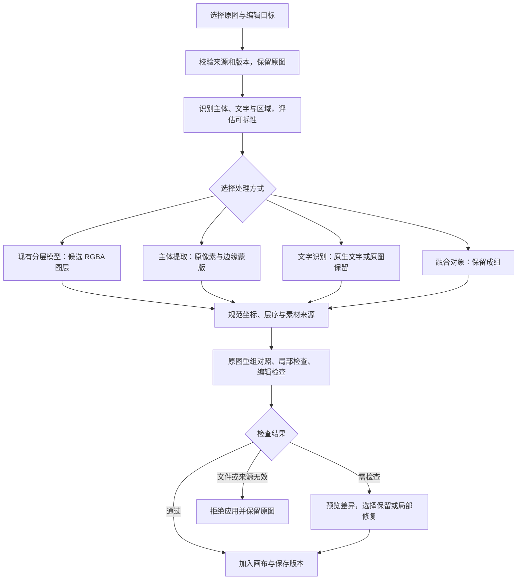

# Nova 分层质量优化开发规划

日期：2026-10-29。状态：第一批 P1 工程改动与本地回归已完成；真实样本 A/B、P2 和 P3 仍待完成。执行记录见[第一批开发日志](../development-log-2026-10-29-layer-quality.md)。

## 1. 工作区与目标

- 工作区：`D:/coding/公司/brandai-layer-quality`。
- 分支：`claude/layer-quality`。
- 基线：`origin/main@3272951480c2a737886a9f4921c30504e7e3cc66`，即 PR #68 合并提交。
- 已确认基线包含 `f83a8a9` 的文案工作台与画布修复。原文案工作区保留原分支及未提交文件。
- 后续指令已授权实现第一批并正常推送该分支；用户明确由 CDS 自动部署，不手动触发平台部署，不创建 PR。新增模型调用为 0。

用户反馈有两个主问题：主体、背景和文字拆不准；拆完后边缘、文字或背景变样。目标是提高实际编辑可用率，而不是增加图层数量。

第一版优先实现：**保留原图 → 分层 → 与原图对照 → 标出问题 → 只处理问题部分 → 可撤销地加入画布**。任意扁平图无损还原为原设计稿不作为承诺；被遮住的内容、未知字体与生成式补全必须明确区分。

## 2. 现有实现与已确认缺口

以下是开发前基线，已实现差异以开发日志为准。

| 项目 | 基线证据 | 对本轮开发的影响 |
|---|---|---|
| 语义规划 | `apps/ai/app/studio_layer_plan.py` 返回组名、描述和层数 | 已有内容分析，不能说当前完全不会看图；还缺目标区域、可拆性与结果对应关系 |
| 分解提示 | `apps/web/src/lib/studio-decomposition-planning.ts` 只拼组名；`apps/ai/app/providers/base.py` 把它作为指定拆分方式的指令 | 需把用户意图、整图描述、内部预期分组分开，按实际模型能力映射 |
| 模型能力 | 官方 Qwen 说明 prompt 用于描述整张输入图，不保证逐层语义控制；Fal 将其定义为 caption | 先修能力适配并做对照，不能把“提示词要求了”当作已实现准确分层 |
| 结果归档 | `apps/web/src/lib/studio-decomposition.ts` 校验可解码、尺寸、透明度及至少两层有有效内容后保存 | 文件有效不代表主体完整、文字正确或重组后保真；需独立质量状态 |
| 坐标与透明度 | `studio-decomposition-images.ts` 已有精确的 Qwen 640 面积桶变换、非零 alpha 保留和 40M 总像素预算 | 保留已修边界；不能任意拉伸非方图，也不能删除很淡但真实的图层 |
| 图层类型 | `packages/contracts/src/studio-decomposition.ts` 当前为 PNG 图层 | 可移动的栅格图层不等于可编辑文字；混合图层需版本化契约 |
| 任务恢复 | 已有远端任务身份、异步队列、归档恢复和来源校验 | 复用现有链路，避免为质量优化引入重复收费或跨项目串图 |
| 画布文字 | `OwnedEditorClient.tsx` 已可将文案作为原生文字加入画布 | 可复用插入、保存、撤销机制；OCR 字体恢复和清除原图残字仍需开发 |

既有 PSD 下载、九层文件和非方图修复证据，仅能证明当时验证过的文件或几何链路，不能替代新一轮语义与视觉质量验收。

## 3. Lovart 材料如何使用

阅读顺序遵循本地 `D:/coding/lovart/README.md`：总报告 → 方法论 → 相关 Skill 分析与原文 → 原始 JSON；前一轮前端静态调查作为补充。

原始 JSON 核实结果：20 张卡片、10 个唯一 `skillKey`、104 个变体；104 个模板包含 `questions`、`inputTemplate`、`renderRules`。`renderRules` 的空行省略与连接符只负责输入拼装，不是图像渲染规则。它们能说明产品工作流，不能证明已取得整个后台或底层分层算法。

| 可借鉴的做法 | Nova 的具体落点 | 证据边界 |
|---|---|---|
| 输入有结构，空字段不强填 | 将源图、修改目标、保留范围、可选要求分开；默认复用已选对象 | 不把 20 个模板全部塞进模型上下文，也不增加重复问卷 |
| 原素材作为依据 | 固定源素材哈希、源尺寸与画布版本；商品与 Logo 优先使用原像素 | 参考图能表达目标，单靠提示词不能保证保真 |
| 不确定时保守处理 | 对融合、附着、遮挡对象保留成组；提示可手工圈选 | 动态海报 Skill 中的原则可借鉴，不是已经验证的分层算法 |
| 分步骤留下证据 | 每步保留状态、输出引用、检查结果、耗时与版本 | 模型自述“已检查”不能当作质量证明 |
| 最小范围重做 | 保留通过的图层；失败只回到对应步骤，重新计费显式显示 | 没有源图与任务版本关系就不能安全复用旧结果 |
| 前景、背景与文字分别处理 | 建立区域、层序、文字与素材类型的统一结果契约 | 本地 bundle 可见消费 `bg_image`、`fg_image`、`text_render_data`；未捕获真实分层请求结果，服务端算法未知 |

报告中“100% 还原”与“白名单不可绕过”等绝对结论不采纳。工具能力必须由执行端校验工具名、参数及资源归属；只在 prompt 中过滤工具不够。原始 Skill 文本、第三方 bundle、账户资料和抓包不复制进本仓库。DeepSeek 替换与通用 Skill 平台不属于本次分层优化范围。

## 4. 目标处理流程

这是 Nova 的设计方案，不宣称是 Lovart 的后台实现。采用现有 Web/BullMQ/AI/存储链路逐步接入，不另起一套系统。

## 5. 分阶段实施清单

### P0：证据、样本与基线

- [x] 核实 main 合并结果，创建独立分支，安装仓库推送检查。
- [x] 复核当前分层代码、Lovart 材料与模型官方说明。
- [ ] 盘点可使用的原图、已产生的真实分层结果、模型参数和失败任务；复用已有输出，不因盘点重新生成。
- [ ] 固定 12 张回归样本：商品/Logo、人物边缘、中文密集排版、文字压图、遮挡融合、透明/非方图各两张；优先纳入用户实际问题图，缺项明确标记。
- [ ] 标注必须保留的区域、预期可编辑对象与可接受分组；区分“适合独立拆分”和“应保守成组”。
- [ ] 建立基线包：原图、逐层图、重新合成图、差异图、失败标签、耗时和可获得的真实成本记录；缺失成本写未知。

交付：固定样本清单与基线报告。技术合成素材只用于边界测试，不能替代真实模型质量样本。

### P1：现有模型适配与质量检查——第一轮主线

- [x] r2 规划增加 `sourceCaption`，保留原 `intent` 和内部 groups；Fal 仅接收整图 caption。r1 继续恢复，缺 caption 时由 provider 自动描述，不补跑分析。
- [x] 版本化保存规划描述；不把计划组名冒充为已经对应到的图层名称。
- [x] 记录独立质量结果，旧任务 `quality=null` 表示未检查；初检阈值版本化，仍待真实基线校准。
- [x] 有序 alpha 合成、全图采样指标及 4×4 局部差异区域；从透明底合成，保留几何与弱 alpha 门禁。
- [x] 分开文件保存与质量状态；仅提示像素差异，明确语义、文字仍需人工复核。
- [x] 按需并排对照、单层查看、开关图层、标记差异区域；不自动替换画布或发起模型调用。
- [ ] 保护区域标注、语义主体完整性和重复文字的专用检查；目前差异框只用于人工定位。
- [ ] 固定真实样本的旧版/新版 A/B，以及阈值和成本校准。

交付：同样本旧版与新版对照、可解释的质量提示。先用四张代表图验证方法，再扩到固定 12 张；不先铺开大量模型调用。

### P2：混合拆分，优先保住主体

- [ ] 定义版本化结果：图层类型、角色、区域、层序、原素材引用、变换、处理来源与检查结果。保留旧栅格任务读取；契约同时更新 Zod/Pydantic。
- [ ] 在已配置可用能力中核实抠图/分割与蒙版输出；未具备能力时明确不可用，不假设 Lovart 的接口可直接调用。
- [ ] 对商品、人物、Logo 等关键对象，验证用原像素加蒙版提取；边缘只调整蒙版，保留主体可见内容。
- [ ] 对移动主体后露出的缺失背景，只在明确的缺口区域补全；蒙版之外复制原像素，补全区域标记为推测内容。
- [ ] 对不可可靠分开的融合/附着对象保留成组；复用已有圈选能力的可行性先审查，不重复建一套复杂工具。
- [ ] 局部修复生成新版本并绑定源图/旧图层；未改图层继续复用，失败不毁掉已有结果。

交付：主体保真与局部修复的纵向小闭环。精确保留区域用像素检查，边缘蒙版和遮挡区域另行评价，不承诺所有边缘像素不变。

### P3：文字可编辑与画布体验

- [ ] OCR 提取文字、区域、旋转与样式候选，校验中文、数字与 Logo 字标。
- [ ] 识别可靠且字体可用时转为画布原生文字；字体/效果不确定时保留原文字图层，并明确说明替代字体的外观差异。
- [ ] 原生文字与原图文字不能同时显示造成重影。去除原图残字必须限定蒙版并通过背景检查，否则保持栅格结果。
- [ ] 复用已存在的文字加入画布、保存、撤销与任务幂等机制；新增分组、选中、改字和撤销的真实浏览器验收。
- [ ] 用户主入口保持“分层编辑”；结果内显示主体/背景/文字和可操作状态，高级参数按需展开。
- [ ] 画布原生可编辑与 PSD 导出的可编辑能力分别验证。当前 PNG 层导出不能宣传为 Photoshop 原生文字层；不支持时注明栅格化。

交付：改一段字、移一个主体、换一个背景都能保存、撤销、重新打开；有局限的对象能看懂原因。

### P4：回归、小范围验证与后续扩展

- [ ] 固定 12 张真实样本重新验收，逐张比较，不用总平均分掩盖 Logo、错字等关键退化。
- [x] 第一批契约、AI、Web 类型、构建、发布合同与现有画布/文案浏览器回归通过；真实模型质量验收单列未完成。
- [x] 本地回归覆盖旧任务、PSD、非方图、弱透明层、跨项目读取、归档恢复及未知提交恢复。真实 DB/worker 验收仍由自动集成流水线执行。
- [ ] 正常推送后只读核对远端状态和实际预览地址；按用户要求不手动部署、不创建 PR，不把 CI 构建成功当作运行验收。
- [ ] 后续新创作优先保留独立文字、Logo、商品素材及背景，从创建时减少压平。先审查现有生成链路；当前 Studio 生成策略使用 `textMode: direct`，不能把历史 layered 能力当作已接通。

## 6. 验收标准与停止条件

| 维度 | 检查方式 | 判定 |
|---|---|---|
| 主体完整 | 人工标注区域、可见部分覆盖、单层查看和实际移动 | 身份/Logo/结构没有被改画；混层与缺失分别记录 |
| 文字 | OCR 对照加人工核对，检查中文、数字和字号效果 | 关键文字零新增错字/重复；不能恢复的明确保留为图片 |
| 边缘 | 黑/白/棋盘背景、100% 与放大检查 | 无新增明显白边、残影、锯齿或透明内容丢失 |
| 重组保真 | 仅由返回图层按层序合成，与原图做全图及局部差异 | 不允许垫一张原图掩盖缺层；差异阈值在基线完成后固定，不临时放宽 |
| 可编辑性 | 移主体、改文字、开关图层、换背景 | 仅看合成图相似不足以通过；层本身必须可用 |
| 几何 | 方图/横图/竖图，区域与变换回算 | 无任意拉伸、裁边或位置漂移 |
| 保存与恢复 | 真 API/DB/worker，保存/刷新/撤销/旧任务 | 不重复插入或收费，不串项目，不丢原版本 |
| 成本和耗时 | 每个步骤的请求次数、耗时、实际用量与失败原因 | 记录单张成功成本与失败消耗；没有账单证据就保留未知 |

拟定首轮目标：12 张全部有可追溯结论；适合拆分的样本中，可完成约定编辑动作的比例至少 80%，且相对同样本基线提高。应成组的样本正确降级单独统计，不能用降级数量充当拆分成功。关键文字、商品身份或 Logo 出现新增破坏即阻止该处理路径推广。

相似度指标作为辅助；只拿到 RGBA、PSD 能打开或模型声称成功，都不等于质量通过。若 P1 对照无改善，就根据缺陷进入 P2 的区域处理，不靠无限加层数、加提示词或重复收费试错。

## 7. 工程与费用边界

- 长操作继续在 worker 执行，BFF 快速受理。每一步带来源版本和幂等身份，用户刷新/离页不重复提交。
- 网络超时但远端提交状态不明时只查原任务，不重新发起收费调用；归档重试与生成重试分开。
- 新任务可有独立质量状态，例如未检查/通过/需复核/拒绝应用；它与旧执行状态分开，最终枚举以双端契约为准。
- 先做现有任务只读盘点和本地检查。真实 A/B 运行前固定样本、每条路径最多调用数、项目总预算与停止条件；预算和新能力是否可用仍待核实。
- 沿用原图身份、素材归属、授权读图、总像素和 PSD 内存预算；不放宽这些检查换取表面成功。
- 输入图、原始结果、含素材的质量报告与账户配置留在私有验收位置；仓库只存必要方案、可公开测试夹具与脱敏结论。

## 8. 工作顺序和工作量预估

| 批次 | 内容 | 预估与依赖 |
|---|---|---|
| 第一批 | P0 样本基线 + P1 能力适配、质量提示和对照 | 约 2–3 个有效开发日；取决于原图及已有真实结果是否齐全 |
| 第二批 | P2 一个主体提取/局部修复闭环 | 约 2–4 个有效开发日；取决于可用分割与蒙版编辑接口 |
| 第三批 | P3 文字与画布 + P4 全量回归 | 约 2–4 个有效开发日；字体、复杂透明对象和模型质量可能增加工作量 |

这些是开发估算，不是上线日期。第一批完成后用真实对照决定后两批具体范围。立即开始开发时，第一项是整理已有真实失败样本与基线，随后修模型参数语义并补质量检查。

## 9. 证据索引

- 本地导航与报告：`D:/coding/lovart/README.md`、`FINAL_REPORT.md`、`METHODOLOGY.md`、`SKILL_MD_ANALYSIS_NOTES.md`；`DEEPSEEK_LOVART_FEASIBILITY.md` 仅作扩展架构参考。
- 原始定义：`D:/coding/lovart/all_skills_feed.json`；路径为各卡片 `content.bind.skillKey` 及 `collectionMembers[*].content.template`。相关原文在 `skills_md/动态海报生成器.md`、`Meta广告创意.md`、`YouTube频道横幅.md`。
- 分层静态证据：`D:/coding/lovart/lovart_scripts/5671.23c9caa4.js`，可检索 `lovart/layer-separation`、`text_render_data`、`bg_image`、`fg_image`。这些是客户端调用/消费证据，不是已运行的分层质量结果。
- 既有 Nova 记录：[分层修复日志](../development-log-2026-10-17-layer-fix.md)、[非方图调查](../non-square-layer-investigation-2026-10-19.md)、[PSD 功能边界](../novart-automatic-psd.md)。旧调查状态以当前代码复核为准。
- [Qwen 官方说明](https://github.com/QwenLM/Qwen-Image-Layered#introduction)：prompt 描述整图，不保证逐层语义控制；2026-10-29 复核。
- [Fal 官方 API](https://fal.ai/models/fal-ai/qwen-image-layered/api)：prompt 为 caption；公开输入包括层数、步数、seed 等，未列区域蒙版或 resolution；2026-10-29 复核。上游开源支持某参数不代表当前托管接口支持。
