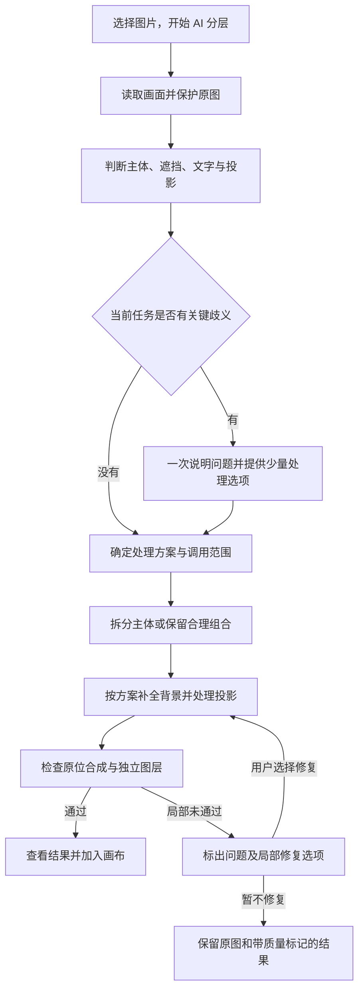

# 分层工作流优化计划：参考 Lovart，优先解决遮挡与背景补全

日期：2026-10-30。工作区 `D:/coding/公司/brandai-layer-quality`，分支 `claude/layer-quality`，规划基线 `e5c01f79132f3b4e70737754a1110e379e9de6ea`。

本次交付为开发计划。功能代码、模型配置和部署均未改动，未调用模型。昨日问题见[反馈与交接](2026-10-29-occlusion-feedback-and-next-steps.md)。本计划细化原分阶段计划的 P0/P2/P4；原生文字恢复 P3 继续作为后续独立范围。

## 1. 目标与完成定义

让用户选中图片后，系统能够判断哪些对象可拆、哪些背景可补、哪些信息需要保持准确，再选择工具生成真正适合独立编辑的图层。

首个验收场景是足球与草地：足球移开后，原位置仍是连续自然的草地，没有球形模糊块、主体残影或孤立球影；足球图层没有明显杂点、草地粘连或黑边；未涉及的白线、背景纹理和构图保持稳定。

“文件生成成功”“原位合成相似”“独立图层可用”分别验收，不能互相替代。隐藏内容的合理补全不宣称为原始像素的准确恢复。

## 2. 参考材料与还原边界

已按本地 README 指引复核总报告、方法论、Skill 分析、原始 Skill，并结合昨日对 20 项 feed 定义和 54 个工具定义的核查。

| 来源 | 可直接借鉴的工作流 | 本项目对应方式 | 证据边界 |
|---|---|---|---|
| 动态海报 Skill §3–4 | 先读原图，锁定主体、文字、标志、结构与风格 | 冻结源素材及画布版本，形成保护项 | 原始 Skill 规则，不能证明模型实际保真 |
| 动态海报 Skill §5、§9.1、§13 | 分类可拆性；可推断的遮挡可以有条件补全；不明确的关系合并澄清 | 可拆性与补全策略独立记录 | 原场景为视频，静态分层需适配 |
| YouTube 横幅 Skill 最终 QA | 锁定像素、检查真实产物、失败修复再检查 | 局部编辑保护区与交付检查 | 不套用横幅尺寸、裁切规格 |
| UGC Skill 执行流程 | 按阶段推进，失败回到对应步骤 | 可恢复的阶段状态和局部返工 | 不把视频 / 音频步骤搬入产品 |
| 工具策略快照 | 执行工具有显式允许范围 | 服务端校验工具、模型能力、参数与操作范围 | 快照不能证明所有权限边界实现情况 |
| lineage 请求样例 | 保存 source、output、operation、canvas version | 源图、蒙版、图层、修复版本可追溯 | 自动增量重算是我们的设计，不能宣称已从样例还原 |

没有获得 Lovart 服务端分割 / 遮挡补全 / 阴影提取算法。20 个 feed 定义中未找到独立的遮挡修复 Skill。这里还原可观察的判断、交互、编排和验收流程；执行能力使用本项目可验证的模型与图像处理代码。

## 3. 目标用户流程

### 交互约定

- 复用当前选中图片和项目上下文，不重复上传或重新选择同一对象。
- 普通草地、天空等背景，只有在本次操作已允许自然补全且已验收的工具可用时自动推进；不为没有歧义的情况反复弹确认。必要的费用和操作范围在提交入口一次说明。
- 人体缺失结构、相互粘连对象、精确产品 / 文字信息等存在实质歧义时，一次集中说明，提供如“保留成组 / 依据参考补全 / 仅提取可见部分”的适用选项，不要求用户选择模型或填写技术字段。
- 结果以当前任务为主。历史失败记录单独折叠并显示时间，避免旧 HTTP 403 被误读为本次失败。
- 进度显示真实阶段：分析画面、拆分主体、补全背景、检查图层；不编造完成百分比。
- 普通用户看到一张简洁的结果卡：图层、原图对照、质量问题、加入画布；蒙版、投影规则和层数放入精细设置。

## 4. 分析与决策：建立我们自己的分层 Skill

实现一个版本化、任务专用的分层规则模块，建议按“源图判断、遮挡决策、工具选择、质量检查”拆分说明与契约。先集成进现有服务，不为此重建通用 Agent 平台。

Skill 输出必须经过 TS / Python 结构校验；执行端不直接运行模型自由生成的工具指令。

建议新增结构（字段名待实施时定稿）：

- `sourceFacts`：可见主体、背景、文字、规则线条；caption 仍只陈述原图事实。
- `groups` / `relations`：对象成组建议、前后遮挡、附着关系；区分建议组名与已经验证的输出层标签。
- `preserveRegions`：文字、Logo、商品结构、主体身份及未编辑区域。
- `occlusionPlan`：被遮挡内容类型、依据、可推断程度、建议动作、需补充的参考。
- `shadowPolicy`：环境阴影保留、主体关联投影随主体处理或独立层；不能统一删除所有阴影。
- `executionPlan`：实际可用的工具、预计付费阶段、最大调用范围与失败出口。
- `validationPlan`：该样例需要的检查；无检查不能直接标记质量通过。

### 遮挡决策表

| 类型 | 默认处理方向 | 额外条件 |
|---|---|---|
| 普通连续纹理 / 背景 | 根据周边局部补全 | 检查纹理和光影，避免用模糊填洞 |
| 白线、砖缝、规则图案 | 按几何、透视、重复规律延续 | 结构不明确则用参考或保留现状 |
| 人体、复杂商品结构 | 评估是否足以合理推断 | 不自动发明关键身份 / 产品细节 |
| 文字、Logo、规格信息 | 原像素保护或依据原始素材重建 | 无依据不生成并宣称准确 |
| 粘连 / 附着对象 | 优先保持合理组合 | 用户需求确实要求拆开时再给具体方案 |
| 透明 / 反射对象、复杂发丝 | 标记专门处理需求 | 首批不承诺稳定自动修复 |

现有 prompt 中“不要假定遮挡可恢复”与“要在说明里强调限制”将改为上述判断规则。仍保留 caption 不猜隐藏内容的要求，避免把修复愿望写进原图描述。

## 5. 执行能力与后端改造

### 5.1 先核查可用工具

保留现有 Fal 分层作为候选图层来源。现有代码已经有背景移除 / 蒙版编辑入口、能力开关和蒙版外原像素回贴；这不等于当前账户和网关已支持或验收这些能力。

第一批先核对实际配置、官方接口、蒙版语义、输出 alpha、尺寸、成本和失败行为。只有完成小样验证才接入自动流程。若缺少可靠主体蒙版，明确选择受验证的分割能力或让用户精细修正，不能把噪点较多的候选 alpha 直接当作准确区域。

### 5.2 主体提取与背景补全分开

1. 以源图和明确的对象范围确定主体蒙版，边缘、透明细节和原尺寸要独立校验。
2. 以原像素加蒙版提取主体为优先路径；生成式抠图候选需检查有没有重画主体，不能直接称无损。
3. 构造背景编辑区域，覆盖主体遮挡区及需要移除的关联投影；区域变化必须有版本记录。
4. 局部补全后，把蒙版外原图像素确定性回贴。接缝需要的过渡边带必须包含在允许编辑的范围内，不能扩大到整图。
5. 阴影无法可靠独立提取时，不伪造“独立阴影层”；根据当前任务保留组合或说明待处理的局部问题。
6. 保存源图、蒙版、处理结果及检查结果的关联，返工只替换受影响的背景 / 主体 / 投影版本。

### 5.3 任务和版本

沿用现有队列、一次提交、结果归档和素材权限体系。建议阶段为：读取源图 → 分析 → 等待必要选择 → 执行 → 检查 → 可交付 / 需复核 / 未完成。

- 分阶段状态与产物持久化，刷新或关闭浏览器不丢任务。
- 澄清等待与模型运行超时分开；不能让“等待用户选择”耗尽模型任务的短时期限。
- 每个付费步骤有稳定身份和回执，提交结果不明时只查原任务，不重发。
- 质量修复创建子步骤和新版本，复用已完成产物；没有明确调用预算时不自动循环修复。
- 存储成功与质量状态独立；有缺陷的候选可以查看，但不能标成验收通过，也不自动替换用户画布内容。
- 已有 r1 / r2 任务只读兼容，不为升级分析契约而补跑模型。

主要代码落点：`packages/contracts/src/studio-decomposition.ts`、`apps/ai/app/studio_layer_plan.py`、`apps/ai/app/studio_decomposition_schemas.py`、`apps/web/src/lib/studio-decomposition*.ts`、现有 worker、`studio-image-tools.ts` / `studio_image_tools.py`。若阶段和版本需新增数据库字段，在契约确定后单独设计兼容迁移。

## 6. 前端改造

主要落点：`OwnedLayerPanel.tsx`、`OwnedLayerComparison.tsx`、`owned-layer-options.ts`、现有任务恢复组件，以及 `OwnedEditorClient.tsx` 中任务 / 图层加入画布逻辑。

| 用户动作 | 目标反馈 |
|---|---|
| 选图开始 | 自动带入对象，展示当前处理范围和必要费用提示 |
| 系统发现关键歧义 | 一张集中选择卡，解释具体对象与影响 |
| 处理进行中 | 显示真实阶段；离开后可恢复 |
| 查看草地层 | 隐藏足球检查背景，支持局部放大 |
| 查看主体层 | 浅色、深色、棋盘格背景切换，检查杂点和边缘 |
| 发现背景补丁 | 指向具体问题，选择仅修复背景；保留已有主体 |
| 加入画布 | 保留原图，选择性展开；撤销、保存、重开一致 |
| 回看历史 | 时间和状态清楚，旧错误不占据当前结果主提示 |

本轮不扩大到主页重做、视频制作或完整 OCR 字体恢复。

## 7. 质量验收与样本

### 两组检查并行保留

1. 原位合成：层序、坐标、主体形状、文字、色彩与原图对照。
2. 独立使用：隐藏 / 移开主体后检查背景；不同底色下检查 alpha、边缘和杂点；投影与主体位置是否协调。

仅用原位重合误差，可能让前景遮住坏的背景补丁。局部纹理差异指标只作辅助；自然补全区域没有原始真值，不能要求它和被遮住的原图像素相等。语义质检若调用视觉模型，需要单列调用与判断依据，模型自评不能取代人工样例复核。

### 首批固定 8 张样例（素材待落实）

- 足球 / 草地：连续纹理与投影；作为首个必过案例。
- 主体遮挡白线：结构延续。
- 商品 / 纯色桌面：原主体像素与接触阴影。
- 规则砖墙 / 前景对象：重复结构和透视。
- 文字或 Logo 重叠：精确信息保护与组合。
- 人体局部遮挡：合理保守处理与具体提示。
- 多个相互遮挡主体：关系及层序。
- 透明物体或复杂发丝：能力边界与诚实降级。

前四类用于核心成功路径，后四类用于决策与边界验收。采用用户自有 / 已许可素材；原图、旧结果和新结果在私有验收区留存，不把项目素材或账户信息提交进仓库。

## 8. 批次、交付物与停止条件

| 批次 | 工作 | 完成判据 |
|---|---|---|
| A：能力和基线 | 取回足球原始图层、验证 alpha；固定旧版结果；核对分割 / 蒙版编辑能力 | 有真实输入和基线；明确可用工具及限制。缺底层能力时先解决此依赖 |
| B：决策工作流 | 结构化遮挡计划、保护项、按需澄清、版本兼容及真实阶段展示 | 常见纹理不再笼统提示不可恢复；歧义对象走对应选择；旧任务不重跑 |
| C：局部处理闭环 | 主体蒙版、背景修复、投影策略、局部版本和一次调用约束 | 足球样例移开后背景自然，未编辑区受保护；失败能定位且局部返工 |
| D：产品与回归 | 单层检查、质量标记、简化结果卡、历史错误区分、8 类样例 | 真实样例评审、画布保存重开 / 撤销、PSD、权限与计费行为通过 |

工作量粗估：A 约 0.5–1 个开发日；B 约 1–2 日；C 约 2–3 日；D 约 1–2 日。共约 4.5–8 个有效开发日，取决于实际模型能力、样本与修复效果；不是上线日期承诺。优先完成足球闭环后再扩充其余样例，避免先铺大工作流再发现底层修复无效。

真实小样运行前明确每条路径的调用上限、成本和停止条件；不以无法解释的持续重试换取偶然成功。测试按改动范围增加必要的契约 / 状态恢复 / 图像保护与浏览器用例，交付前完成仓库要求的全量门禁。后续推送和部署只沿用当次明确授权的分支与发布范围。

## 9. 当前完成情况

- [x] 阅读昨日反馈，复核当前分支与相关代码。
- [x] 核对 Lovart 原始 Skill、报告与现有能力的差异。
- [x] 明确前后端工作、实施顺序和可观察的验收标准。
- [ ] A–D 实施与真实质量验证：尚未开始。

## 10. 证据索引

- `D:/coding/lovart/README.md`：材料导航。
- `D:/coding/lovart/skills_md/动态海报生成器.md`：§3（125 行）、§4（148 行）、§5（167 行）、补全选项（215 行）、§9.1（547 行）、§13（985 行）、§14（1021 行）。
- `D:/coding/lovart/skills_md/YouTube频道横幅.md`：Pixel-Locked Canvas / Final QA，约 90–118 行。
- `D:/coding/lovart/skills_md/UGC广告导演.md`：主状态链及按需加载章节。
- `D:/coding/lovart/FINAL_REPORT.md`：§5.2 工具策略快照；解释性结论需与原始证据区分。
- `D:/coding/lovart/METHODOLOGY.md`：§0.7 问答反推的 QA，§2.7 lineage 请求样例。
- [上一批开发日志](../development-log-2026-10-29-layer-quality.md)、[原分阶段计划](2026-10-29-layer-quality-plan.md)。
